  

  <b>Payment infrastructure for businesses that sell everywhere.</b> 
  Cards, QRIS, e-wallets, PayPal and bank transfers in one account, one balance and one report.

  <a href="https://dashboard.usezeny.com/signup"><b>Create free account</b></a>
  &nbsp;·&nbsp;
  <a href="https://usezeny.com">Website</a>
  &nbsp;·&nbsp;
  <a href="https://usezeny.com/#pricing">Pricing</a>
  &nbsp;·&nbsp;
  <a href="https://docs.usezeny.com">Guides</a>
  &nbsp;·&nbsp;
  <a href="mailto:hello@usezeny.com">Talk to us</a>

 

## One account instead of three vendors

| | |
|---|---|
| **Payments** | Virtual accounts, QRIS, cards, e-wallets and retail counters on one hosted page. |
| **Payment links** | Get paid in WhatsApp, Instagram or TikTok, with no website. |
| **Payouts** | Single or bulk from a CSV. Every account name is checked before money leaves. |
| **Sub-accounts** | A separate balance and report for each outlet, branch or partner. |
| **Subscriptions** | Monthly and yearly plans that retry failed charges for you. |
| **Reports** | Ledger, settlement and fee exports your finance team won't have to redo. |

**Settle in USD, SGD or IDR.** Money lands the next day. There's no setup or monthly fee, and a failed payment costs nothing.

## Made for how you sell

- **Online shops**: send a payment link in chat and get notified the moment it's paid.
- **F&B and retail**: a QRIS at every counter and a sub-account per outlet.
- **SaaS and memberships**: card billing on schedule, with smart retries.
- **Marketplaces**: collect once, keep your commission, pay every seller in one file.
- **Lending and cooperatives**: disburse to verified accounts and collect repayments by virtual account.
- **Education and events**: one account number per student or ticket, matched automatically.

## For developers

Sign up and you get sandbox keys in about two minutes. You can simulate paid, expired and failed payments before going live.

- **REST API** for payments, payouts and accounts
- **Signed webhooks** with automatic retries
- **Idempotency keys** on every money-moving request, so a retry never charges twice
- **Sandbox and production** kept apart, with the same API in both

### Official SDKs

| SDK | Language | Install |
|---|---|---|
| **[@usezeny/node](https://www.npmjs.com/package/@usezeny/node)** | Node.js and TypeScript | `bun add @usezeny/node` |
| **[usezeny/laravel](https://github.com/Zeny-Pay/zeny-laravel-sdk)** | PHP 8.2+ and Laravel 12/13 | `composer require usezeny/laravel` |
| **zeny-go** | Go | Coming soon |

Both SDKs cover payment links, signed webhook verification and automatic retries that never charge twice. Any HTTP client works against the REST API too. Want to know when the Go SDK is out? Watch this organization or email [hello@usezeny.com](mailto:hello@usezeny.com).

The API reference is in the dashboard under **Help → Docs**. Merchant guides are public at [docs.usezeny.com](https://docs.usezeny.com).

## Trust and safety

Zeny runs on licensed payment partners. Every business is checked before it can accept money: ID read automatically, face matched, and settlement account name verified. Read how we protect your data on our [security page](https://usezeny.com/security).

Found a security issue? Email [support@usezeny.com](mailto:support@usezeny.com) with "Security" in the subject instead of opening a public issue.

 

  
   
  
    <a href="https://www.linkedin.com/company/usezeny">LinkedIn</a>
    &nbsp;·&nbsp;
    <a href="https://instagram.com/usezeny">Instagram</a>
    &nbsp;·&nbsp;
    <a href="mailto:hello@usezeny.com">hello@usezeny.com</a>
  

